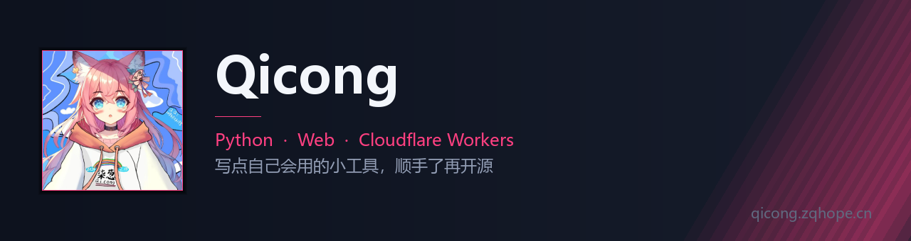

  

  

 

写 Python 和一点前端，兴趣是把想要的东西自己搭出来 —— 桌面上跑的、服务器上跑的、Worker 里跑的。

手上这些项目的起点基本都是「这个我自己要用」：桌宠是为了屏幕角落不那么空，书签测活是因为收藏夹里躺了三年死链，Unicode 转换是因为懒得开在线工具，主题是因为看不顺眼现成的。自己用顺手了，才整理成能给别人用的样子。

大部分时间在 Cloudflare Workers / D1 / KV 上折腾自建服务，另外管几台 VPS。白天写代码，晚上修自己写出来的 bug。

 

## 最近在做什么

**[qiqi77](https://github.com/chenqicong528/qiqi77-typecho)** —— 一个 Typecho 主题。起因很简单：手上这个博客用了三年的主题，改一处颜色要翻三个 CSS 文件，索性重写一套。

现在的版本后台能调 80 项，分 10 组，带搜索。听起来像堆功能，其实是为了少改代码——每次想调点什么都要开编辑器，这事本身就说明设计没做好。

顺手把动态 sitemap、百度推送也做进去了，省得再装插件。

 

## 自研项目

| 项目 | 说明 | 技术 |
| :--- | :--- | :--- |
| **[qiqi77-typecho](https://github.com/chenqicong528/qiqi77-typecho)** | Typecho 卡片式主题。毛玻璃、深浅色、PJAX、80 项后台配置 | `PHP` `MIT` |
| **[qicong-pet](https://github.com/chenqicong528/qicong-pet)** | 柒葱桌宠 —— Windows 桌面看板娘。24 节气皮肤、音乐节奏灯、便签、番茄钟，支持模组扩展 | `Python` `MIT` |
| **[Unicode](https://github.com/chenqicong528/Unicode)** | Unicode 与中文互转。粘贴即转，双向，不用装环境也不用联网 | `HTML` |
| **[LinkVerification](https://github.com/chenqicong528/LinkVerification)** | 书签 HTML 批量测活。并发探链接，标记失效项，导出干净的那一份 | `HTML` `JS` |
| **[oh-404](https://github.com/chenqicong528/oh-404)** | 一个自己写的 404 页面，静态站直接拿来用 | `CSS` |
| **[dd3plusdriver](https://github.com/chenqicong528/dd3plusdriver)** | 炫龙 DD3 Plus 驱动备份。老机器重装前先存一份，省得到处翻 | `归档` |

 

## 技术栈

  
  
  
  
  
  
  
  
  

  
  
  
  
  

 

## 也在折腾

Cloudflare Workers 生态的自建服务：服务器监控探针（D1 + Durable Objects，离线告警 / 到期通知 / 历史延迟）、在线剪贴板与文件分享、图床、订阅转换、多模型 AI 面板。上游 fork 过来改配置，跑在自己的域名下。

另外维护一个跑了九年的博客，写过点相机、路由器、折腾记录之类的东西。写文章比写代码慢，但比写文档快。

 

## 关于这个博客

[qicong.zqhope.cn](https://qicong.zqhope.cn) —— 2017 年开的，中间换过两次域名、四次主题。

现在跑的是 Typecho + 自己写的 [qiqi77](https://github.com/chenqicong528/qiqi77-typecho)。没什么流量，主要是给自己留个地方放东西——哪天想起来「那个配置怎么弄的」，翻自己博客比翻收藏夹快。

 

<picture>
  <source media="(prefers-color-scheme: dark)" srcset="https://github-readme-stats.vercel.app/api?username=chenqicong528&show_icons=true&include_all_commits=true&count_private=true&hide_border=true&theme=tokyonight&rank_icon=github&locale=cn&card_width=440" />
  
</picture>

<picture>
  <source media="(prefers-color-scheme: dark)" srcset="https://github-readme-stats.vercel.app/api/top-langs/?username=chenqicong528&layout=compact&langs_count=8&hide_border=true&theme=tokyonight&locale=cn&card_width=340" />
  
</picture>

 

<picture>
  <source media="(prefers-color-scheme: dark)" srcset="https://github-profile-trophy.vercel.app/?username=chenqicong528&theme=tokyonight&no-frame=true&no-bg=true&column=7&margin-w=8&margin-h=8" />
  
</picture>

 

  

 

<picture>
  <source media="(prefers-color-scheme: dark)" srcset="https://raw.githubusercontent.com/chenqicong528/chenqicong528/output/snake-dark.svg" />
  
</picture>

 

  

工具做出来是给自己用的，顺手了再开源。

